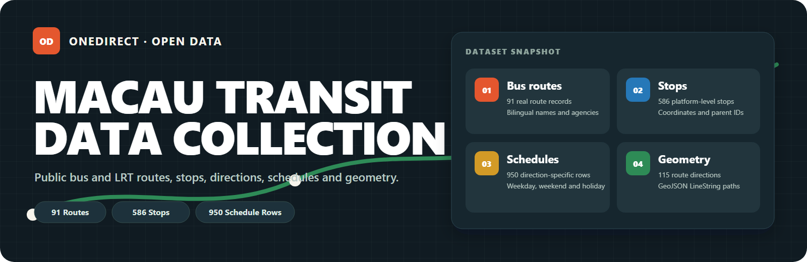
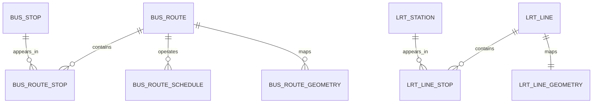

# 🚌 OneDirect Open Data

<p align="center">
  澳門真實公共交通資料集
</p>

<p align="center">
  
</p>

<p align="right">
  <strong>繁體中文</strong>
</p>

<p>
  <kbd>91 Bus Routes</kbd>
  <kbd>586 Platform Stops</kbd>
  <kbd>950 Schedule Rows</kbd>
  <kbd>115 Route Geometries</kbd>
  <kbd>UTF-8 JSON</kbd>
  <kbd>Apache-2.0</kbd>
</p>

> **一套可直接重用的澳門巴士及輕軌公開交通資料。**
>
> 巴士資料按 `ngsiolei/macau-bus-data` 的 `master` 快照整理；輕軌資料沿用專案內非 Mock 的公開目錄。路線、站點、方向、站序、服務日、時段、班距及線形均保留來源內容。

## 📊 資料集狀態

| 項目 | 狀態 |
| --- | --- |
| Dataset version | Macau bus snapshot `be48ee6` |
| Snapshot date | 2023-01-27 |
| Format | UTF-8 JSON |
| License | Apache License 2.0 |
| Bus routes | 91 |
| Bus platform stops | 586 |
| Bus route-stop links | 2,843 |
| Bus schedule rows | 950 |
| Bus route geometries | 115 |
| LRT lines | 3 |
| LRT stations | 15 |
| Source match | Exact |
| Sensitive scan | Clean |
| Last verified | 2026-11-22 |

## 🧭 目錄

- [資料集總覽](#overview)
- [檔案清單](#files)
- [版本與來源](#sources)
- [資料關聯](#relationships)
- [Quick Start](#quick-start)
- [TypeScript Interfaces](#interfaces)
- [欄位字典](#dictionary)
- [資料品質與缺值](#quality)
- [安全與去敏化](#security)
- [驗證方式](#verification)

<a id="overview"></a>

## 🌐 資料集總覽

本資料集把巴士及輕軌資料拆成獨立 JSON，方便搜尋、地圖顯示、路線詳情、班次查詢及後續資料庫匯入。

| 能力 | 對應檔案 |
| --- | --- |
| 路線搜尋及路線基本資料 | `bus-routes.json`, `lrt-lines.json` |
| 站點搜尋及座標顯示 | `bus-stops.json`, `lrt-stations.json` |
| 路線方向及站序 | `bus-route-stops.json`, `lrt-line-stops.json` |
| 服務日、營運時段及班距 | `bus-route-schedules.json` |
| 地圖路線繪製 | `bus-route-geometries.json`, `lrt-line-geometries.json` |

> 巴士站點採用平台／月台級 `stopId`，並以 `parentStopId` 保留父站關係。不要把 `stopId` 與 `parentStopId` 當成同一個鍵使用。

<a id="files"></a>

## 📦 檔案清單

| 檔案 | 筆數 | 用途 |
| --- | ---: | --- |
| [`bus-routes.json`](./bus-routes.json) | 91 | 巴士路線、葡文名稱、類型及營運商 |
| [`bus-route-schedules.json`](./bus-route-schedules.json) | 950 | 巴士方向、服務日、時段及班距 |
| [`bus-stops.json`](./bus-stops.json) | 586 | 平台級巴士站、父站、名稱及座標 |
| [`bus-route-stops.json`](./bus-route-stops.json) | 2,843 | 巴士路線方向及站序 |
| [`bus-route-geometries.json`](./bus-route-geometries.json) | 115 | 巴士各方向 GeoJSON 線形 |
| [`lrt-lines.json`](./lrt-lines.json) | 3 | 輕軌路線基本資料 |
| [`lrt-stations.json`](./lrt-stations.json) | 15 | 輕軌站點及座標 |
| [`lrt-line-stops.json`](./lrt-line-stops.json) | 17 | 輕軌來源站序 |
| [`lrt-line-geometries.json`](./lrt-line-geometries.json) | 3 | 輕軌 GeoJSON 線形 |

<a id="sources"></a>

## 🗂️ 版本與來源

| 資料 | 來源 |
| --- | --- |
| Bus routes | `ngsiolei/macau-bus-data` → `routes.json` |
| Bus stops | `ngsiolei/macau-bus-data` → `stops.json` |
| Bus schedules | `ngsiolei/macau-bus-data` → `route-schedule/` |
| Bus geometry | `ngsiolei/macau-bus-data` → `geojson/` |
| LRT lines | 專案內 `server/data/lrt-lines.json` |
| LRT stations | 專案內 `server/data/stations.json` |

巴士快照 commit：

```text
be48ee689184f718bf66699cfd87d4c54dfc49d8
```

明確 Mock 或虛構資料不使用，包括：

- `src/data/mockData.js`
- `src/data/stationRoutesMock.js`
- `OneDirect-OpenSource` 內的虛構 fixtures

<a id="relationships"></a>

## 🔗 資料關聯



關聯鍵：

| 關聯 | 鍵值 |
| --- | --- |
| Bus route → route-stop | `routeId` |
| Bus route-stop → stop | `stopId` |
| Bus route → schedule | `routeId` + `directionIndex` |
| Bus route → geometry | `routeId` + `directionIndex` |
| LRT line → line-stop | `lineId` |
| LRT line-stop → station | `stopId` |

<a id="quick-start"></a>

## 🚀 Quick Start

```ts
import busRoutes from "./bus-routes.json";
import busStops from "./bus-stops.json";
import busRouteStops from "./bus-route-stops.json";
import busRouteSchedules from "./bus-route-schedules.json";
import busRouteGeometries from "./bus-route-geometries.json";

const routeId = "1";
const directionIndex = 0;

const route = busRoutes.find((item) => item.routeId === routeId);

const stopsById = new Map(
  busStops.map((stop) => [stop.stopId, stop]),
);

const orderedStops = busRouteStops
  .filter(
    (item) =>
      item.routeId === routeId &&
      item.directionIndex === directionIndex,
  )
  .sort((left, right) => left.sequence - right.sequence)
  .map((item) => stopsById.get(item.stopId));

const weekdaySchedule = busRouteSchedules
  .filter(
    (item) =>
      item.routeId === routeId &&
      item.directionIndex === directionIndex &&
      item.serviceType === "weekdays",
  )
  .sort((left, right) => left.scheduleIndex - right.scheduleIndex);

const geometry = busRouteGeometries.find(
  (item) =>
    item.routeId === routeId &&
    item.directionIndex === directionIndex,
);
```

<a id="interfaces"></a>

## 🧩 TypeScript Interfaces

```ts
interface Coordinates {
  latitude: number;
  longitude: number;
}

interface BusRoute {
  routeId: string;
  name: string;
  namePt: string;
  mode: "bus";
  routeType: "2-way" | "circular";
  directionCount: number;
  agencyNames: string[];
}

type BusServiceType = "weekdays" | "weekends" | "holidays";

interface BusRouteSchedule {
  routeId: string;
  directionIndex: number;
  scheduleIndex: number;
  serviceType: BusServiceType;
  start: string | null;
  end: string | null;
  minFrequencyMinutes: number | null;
  maxFrequencyMinutes: number | null;
}

interface BusStop {
  stopId: string;
  parentStopId: string;
  name: string;
  namePt: string;
  mode: "bus";
  coordinates: Coordinates;
}

interface BusRouteStop {
  routeId: string;
  directionIndex: number;
  directionName: string;
  sequence: number;
  stopId: string;
}

interface LineStringGeometry {
  type: "LineString";
  coordinates: [longitude: number, latitude: number][];
}

interface BusRouteGeometry {
  routeId: string;
  directionIndex: number;
  geometry: LineStringGeometry;
}

interface LrtLine {
  lineId: string;
  name: string;
  nameZh: string;
  mode: "lrt";
  color: string;
}

interface LrtStation {
  stopId: string;
  name: string;
  nameEn: string;
  namePt: string;
  mode: "lrt";
  coordinates: Coordinates;
  lineIds: string[];
}

interface LrtLineStop {
  lineId: string;
  sequence: number;
  stopId: string;
}

interface LrtLineGeometry {
  lineId: string;
  geometry: LineStringGeometry;
}
```

<a id="dictionary"></a>

## 📚 欄位字典

### Bus Routes

| 欄位 | 類型 | 說明 |
| --- | --- | --- |
| `routeId` | `string` | 公開巴士路線編號 |
| `name` | `string` | 中文路線名稱 |
| `namePt` | `string` | 葡文路線名稱 |
| `routeType` | `string` | `2-way` 或 `circular` |
| `directionCount` | `number` | 來源方向數 |
| `agencyNames` | `string[]` | 營運商中文名稱 |

### Bus Schedules

| 欄位 | 類型 | 說明 |
| --- | --- | --- |
| `directionIndex` | `number` | 巴士方向，值為 `0` 或 `1` |
| `scheduleIndex` | `number` | 同一方向內按來源行序排列 |
| `serviceType` | `string` | `weekdays`, `weekends` 或 `holidays` |
| `start` | `string \| null` | 時段開始時間 |
| `end` | `string \| null` | 時段結束時間 |
| `minFrequencyMinutes` | `number \| null` | 最短班距 |
| `maxFrequencyMinutes` | `number \| null` | 最長班距 |

### Bus Stops

| 欄位 | 類型 | 說明 |
| --- | --- | --- |
| `stopId` | `string` | 平台／月台級站點代碼 |
| `parentStopId` | `string` | 父站代碼 |
| `name` | `string` | 中文站名 |
| `namePt` | `string` | 葡文站名 |
| `coordinates` | `Coordinates` | WGS 84 經緯度 |

### Geometry

- `coordinates` 採用 GeoJSON 標準的 `[longitude, latitude]`。
- `type` 固定為 `LineString`。
- 巴士幾何使用 `routeId` 及 `directionIndex` 定位。
- 輕軌幾何使用 `lineId` 定位。

<a id="quality"></a>

## 🧪 資料品質與缺值

| 情況 | 筆數 | 處理方式 |
| --- | ---: | --- |
| 巴士排班缺少開始或結束時間 | 30 | `start` / `end` 設為 `null` |
| 巴士排班缺少班距 | 30 | `minFrequencyMinutes` / `maxFrequencyMinutes` 設為 `null` |
| `71S` 使用單一班距值 `15` | 2 | 表示為 `15` 至 `15` |
| `701X` 方向 `1` 缺少排班 | 1 個方向 | 保留方向及站序，不補造班次 |
| 輕軌來源沒有方向標記 | - | `lrt-line-stops.json` 不加入推測方向 |

<a id="security"></a>

## 🔐 安全與去敏化

已清理或排除：

- 營運商電話及網站
- API Key、Token、Cookie 及認證憑證
- Authorization、自訂 Headers 及私密接口參數
- 後台 URL、來源網址及抓取頁面 metadata
- `sourceImage`、圖片路徑及抓取流程資料
- 內部調試欄位、前端常數及 provider／cache／retry 設定
- GeoJSON 中重複的站點 point features

未輸出：

- ETA
- 實時車輛位置
- 票價

上述資料未包含在本次巴士快照中，因此沒有虛構或補值。

<a id="verification"></a>

## ✅ 驗證方式

```powershell
node -e "JSON.parse(require('fs').readFileSync('bus-routes.json','utf8')); console.log('OK')"
```

完整驗證應包括：

- 所有 JSON 可被 `JSON.parse()` 解析
- UTF-8 無 BOM
- `routeId`、`stopId`、`lineId` 跨檔參照有效
- 每個路線方向的站序連續
- 排班方向存在於路線站序資料
- GeoJSON `LineString` 可對應路線方向
- 敏感字詞掃描零命中

## 📄 License

本資料目錄以 **Apache License 2.0** 授權。

完整條款請參閱 [`LICENSE`](./LICENSE)。

```text
SPDX-License-Identifier: Apache-2.0
```
